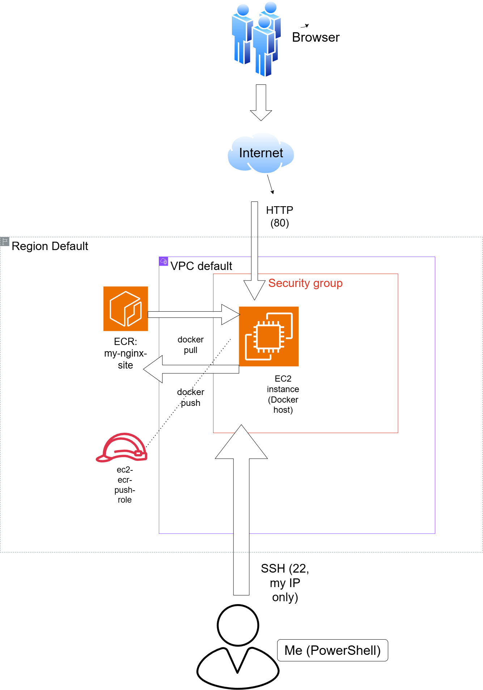
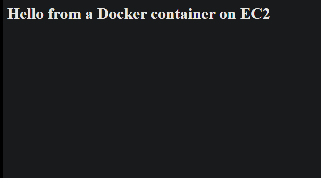
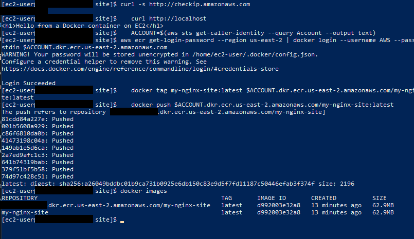
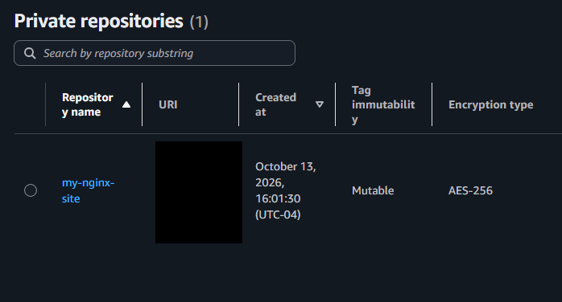
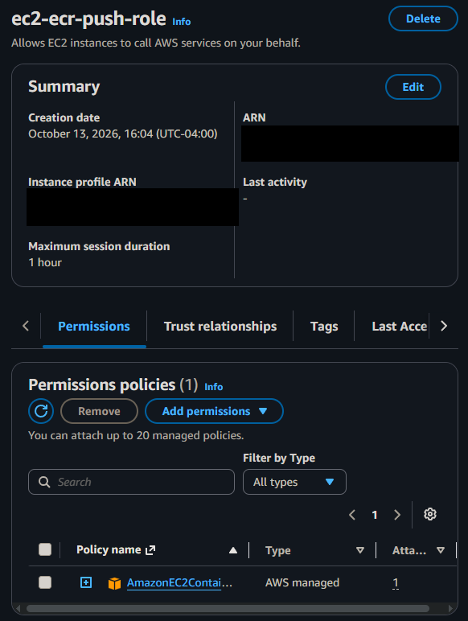
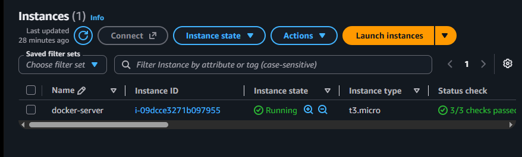

# Docker + Amazon ECR on EC2

I built a Docker image on an Amazon EC2 server, pushed it to a private Amazon ECR repository, then pulled it back from ECR and ran it as a container serving a web page. This is my fourth AWS project, based on a YouTube tutorial about pushing Docker images from EC2 to ECR, with my own page and setup choices.

## Architecture



```
Build:   EC2 (Docker) -> docker push -> ECR private repository
Deploy:  ECR -> docker pull -> EC2 (Docker container running nginx)
Access:  Browser -> HTTP (80) -> EC2 -> container
         Me (PowerShell) -> SSH (22, my IP only) -> EC2
```

| Component | Details |
|---|---|
| Amazon EC2 | Amazon Linux 2023, free-plan eligible `t3.micro`, region us-east-2 (Ohio) |
| Docker | Installed on the instance, used to build, tag, push, pull, and run the image |
| Amazon ECR | Private repository `my-nginx-site`, mutable tags, AES-256 encryption |
| IAM role | `ec2-ecr-push-role` with the AWS managed ECR PowerUser policy, attached to the instance so no access keys are needed |
| Security group | SSH (22) from my IP only, HTTP (80) from anywhere |
| Image | `nginx:alpine` with one custom `index.html` (about 63 MB) |

## Screenshots

**Page served from the container**



**Build, login, and push in the terminal**



**Image stored in ECR**



**IAM role attached to the instance**



**Running instance**



I covered IP addresses, hostnames, the account ID, and ARNs in these screenshots.

## Steps I followed

1. Created a private ECR repository named `my-nginx-site`.
2. Created an IAM role for EC2 with the ECR PowerUser policy, so the server can push and pull without access keys.
3. Launched an Amazon Linux `t3.micro` instance with that role attached, a new key pair, and a security group allowing SSH from my IP and HTTP from anywhere.
4. Connected over SSH from Windows PowerShell as `ec2-user`.
5. Installed and started Docker, and added `ec2-user` to the `docker` group:
   ```
   sudo dnf install docker -y
   sudo systemctl start docker
   sudo usermod -aG docker ec2-user
   ```
6. Created a page and a Dockerfile, built the image, and tested it:
   ```
   mkdir ~/site && cd ~/site
   echo '<h1>Hello from a Docker container on EC2</h1>' > index.html
   printf 'FROM nginx:alpine\nCOPY index.html /usr/share/nginx/html/index.html\n' > Dockerfile
   docker build -t my-nginx-site .
   docker run -d -p 80:80 --name web my-nginx-site
   ```
7. Logged in to ECR with the instance role, tagged the image, and pushed it:
   ```
   ACCOUNT=$(aws sts get-caller-identity --query Account --output text)
   aws ecr get-login-password --region us-east-2 | docker login --username AWS --password-stdin $ACCOUNT.dkr.ecr.us-east-2.amazonaws.com
   docker tag my-nginx-site:latest $ACCOUNT.dkr.ecr.us-east-2.amazonaws.com/my-nginx-site:latest
   docker push $ACCOUNT.dkr.ecr.us-east-2.amazonaws.com/my-nginx-site:latest
   ```
8. Proved the ECR copy works by deleting the local image and running it straight from ECR:
   ```
   docker rm -f web
   docker rmi my-nginx-site:latest $ACCOUNT.dkr.ecr.us-east-2.amazonaws.com/my-nginx-site:latest
   docker run -d -p 80:80 --name web $ACCOUNT.dkr.ecr.us-east-2.amazonaws.com/my-nginx-site:latest
   ```

## Problems I hit and how I solved them

### 1. The page wouldn't load in my browser
- **Symptom:** The container was running, but the page showed an error in my browser.
- **Diagnosis:** I checked from the inside out. `docker ps -a` showed the container as Up with port 80 mapped, `docker logs web` showed nginx started cleanly, and `curl http://localhost` on the server returned my page. From my PC, `curl.exe` returned the page too, and the page also loaded on my phone over mobile data.
- **Cause:** Since the server, container, and security group were all fine, the problem was my browser, most likely forcing the address to `https://` when this server only serves plain HTTP on port 80.
- **Fix:** Opened the plain `http://` address in a browser without the HTTPS upgrade.
- **Lesson:** Test from several places (inside the server, from my PC with `curl`, and from another network) to find which layer is failing before changing any settings.

### 2. Avoiding access keys
- **Problem:** Most tutorials log in to ECR with `aws configure` and long-lived access keys, which I wanted to avoid.
- **Solution:** Attached an IAM role to the instance. The AWS CLI picks up temporary credentials from the role automatically, so `aws ecr get-login-password` worked with no keys stored anywhere.
- **Note:** `docker login` printed a warning that the password is stored unencrypted in `config.json`. That's expected, and the ECR token expires after 12 hours.

## What I learned

- The difference between a Docker image and a container, and how build, tag, push, and pull fit together
- How ECR stores images, and how an EC2 instance role replaces access keys
- Why a public server gets automated scans within minutes: my logs showed a scanner's requests shortly after the container started
- How to troubleshoot in layers: container status, logs, local test, remote test
- That ECR bills for stored images, so cleanup includes the repository

## Cleanup

When finished, I terminated the instance and deleted the ECR repository, the security group, the key pair, the IAM role, and the local `.pem` file. I confirmed no volumes or Elastic IPs were left.

## Next steps

- Automate the build and push with a GitHub Actions workflow
- Run the container on ECS Fargate instead of managing an EC2 server
- Add HTTPS with a load balancer and certificate
- Define the whole setup with Terraform
